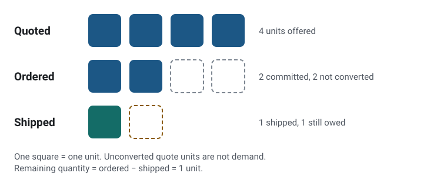

# B2B Sales Systems Case Study

**A proposed design that keeps quotes, orders and shipments separate, so the same demand isn’t counted twice.**

[Read the case study](https://h-yang-26.github.io/projects/b2b-sales-systems-case-study/) · [How this was built](#how-this-was-built) · [Portfolio](https://h-yang-26.github.io/)

<picture>
  <source media="(prefers-color-scheme: dark)" srcset="docs/order-quantities-dark.svg">
  
</picture>

*The worked example from `examples/fictional-order-scenario.json`: 4 quoted − 2 accepted = 2 unconverted; 2 ordered − 1 shipped = 1 remaining. Figure from the portfolio site.*

> **A hypothetical systems-design exercise.** This is an independent, fictional case study about a made-up distributor. It is **not** an employer implementation, a deployed CRM or ERP, or a description of any real company's system. Every name, date, price, and quantity is invented.

## Purpose

To show how a B2B distributor moves from customer interest to a quotation, a committed order, fulfillment, and after-sales service, and why the different *meanings* of business data (an offer, a commitment, a reservation, a shipment) justify different software responsibilities.

It is primarily a documentation and reasoning project. The only code is a small standard-library script that checks the example's arithmetic and computes the metrics, plus tests.

## The scenario in one table

A fictional customer asks about 4 units of a benchtop centrifuge, approves an order for 2, receives 1, and awaits the other 1. Snapshot: 2026-03-20 17:00 UTC.

| Quantity | Units | Meaning |
| --- | --- | --- |
| Quoted (`QUO-2001`) | 4 | An offer and a demand signal, not a commitment |
| Ordered (`SO-3001`) | 2 | Committed demand |
| Unconverted quote quantity | 2 | Quoted but never ordered; not demand |
| Shipped (`SHP-4001`) | 1 | Physically sent |
| Remaining order quantity | 1 | `ordered_quantity - shipped_quantity` = 2 - 1 |
| On hand / reserved | 0 / 0 | Warehouse facts, separate from what is owed |

These are not interchangeable, and adding them (for example 4 + 2) would count the same customer need twice.

## Learning goals

- Distinguish opportunity, quote, accepted order, open order quantity, reservation, and shipment.
- Treat estimates (expected dates), observed facts (confirmed receipt), and missing values (unknown ETA) as different things.
- Give each business fact one logical owner, and see why a modular monolith can be enough.
- Define metrics with explicit units, populations, time bases, and denominators.
- Record design decisions with their consequences and limits.

## Navigate

| Read | For |
| --- | --- |
| [docs/sales-lifecycle.md](docs/sales-lifecycle.md) | Lead -> opportunity -> quote -> order -> fulfillment -> invoice/payment -> service, with optional branches |
| [docs/data-model.md](docs/data-model.md) | Entity glossary, quantity vocabulary, committed demand, and the "remaining unit ships" walkthrough |
| [docs/system-architecture.md](docs/system-architecture.md) | A Mermaid business-process diagram, a Mermaid logical architecture, and an ownership table |
| [docs/design-decisions.md](docs/design-decisions.md) | Three short ADRs (Context -> Decision -> Consequences) |
| [docs/business-metrics.md](docs/business-metrics.md) | Five metrics with formulas, denominators, and invented numeric examples |
| [examples/fictional-order-scenario.json](examples/fictional-order-scenario.json) | The shared fictional record set |

Suggested order for a first read: this page, then the lifecycle, data model, and architecture documents.

## Run the checks

Requires Python 3.11 or newer. There are no third-party dependencies, so there is nothing to install. On macOS or Linux, use `python3` if `python` is not available.

```bash
python scripts/scenario_calc.py
python scripts/check_docs.py
python -m unittest discover -s tests -v
```

- `scripts/scenario_calc.py` loads the JSON, runs consistency checks (amounts, quantity chain, reservations, walkthrough, cohort), and prints the five metrics for the scenario and the invented cohort. It treats the cohort rows as already filtered and enforces only some of the documented metric rules; [docs/business-metrics.md](docs/business-metrics.md) lists which ones.
- `scripts/check_docs.py` checks that local Markdown links resolve, that identifiers in the documents exist in the JSON (and vice versa), that Mermaid fences are closed, and that the documents state the scenario's key quantities.
- `tests/test_scenario_calc.py` tests the calculation functions, including edge and error cases.

Outputs are printed to the terminal only; nothing is written to disk. Run the commands above in your environment to reproduce results. Tested by an agent on Ubuntu 24.04 with Python 3.13.18 (2026-10-29): both scripts pass and all 30 tests pass. macOS has not been tested.

The Mermaid diagrams are rendered by GitHub in Markdown. Both were previously rendered with Mermaid 10.9.1 in a Chromium-based browser; GitHub rendering should be checked independently.

## What I would build next (hypothetically)

This is future work. None of it exists in this repository, and nothing here claims it was built.

- A small modular-monolith prototype (for example Python with SQLite) implementing Orders and Inventory and Fulfillment with the ownership rules from ADR-001 to ADR-003.
- Cancellations, returns, and amended orders, with a revised remaining-quantity formula and status model.
- Quote revisions and quote expiry handling.
- Allocation of scarce stock among competing orders instead of one order and one SKU.
- A read-only reporting view generated from the JSON that renders the five metrics, once the definitions have been reviewed.
- Rendering the diagrams in CI so syntax errors are caught automatically.

## Limitations

- One SKU, one warehouse, one currency, one price; no tax or discounts.
- Cancellations and returns are excluded, so `remaining_order_quantity = ordered_quantity - shipped_quantity` is valid only for this first version.
- The metric cohort is five invented rows. The numbers illustrate arithmetic and denominators, not performance.
- The design is conceptual and untested against a real business.

## How this was built

All data in this project is fictional, and the results say nothing about my employer’s systems. The case study was written independently of my employer: AI tools produced the documents, fictional scenario and checking scripts under my direction, and I approved the results. [How these were built](https://h-yang-26.github.io/how-these-were-built/) on the portfolio site explains who decided what and how the results were checked.

## Attribution and licensing

- The design uses general, publicly known B2B sales concepts and original, invented examples.
- Mermaid diagram syntax is documented at [mermaid.js.org](https://mermaid.js.org/); no Mermaid code is bundled here.
- The scripts use only the Python standard library.
- No license has been chosen for this repository; no general reuse license is granted.
