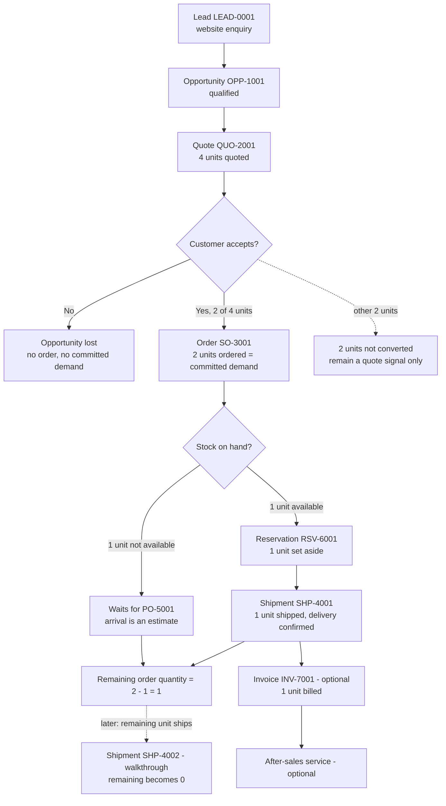
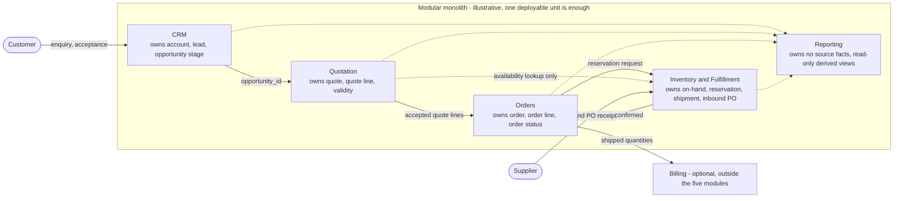

# System Architecture (Hypothetical, Fictional)

Two conceptual diagrams for the invented distributor, plus a table of who owns which fact. Identifiers and quantities match [`examples/fictional-order-scenario.json`](../examples/fictional-order-scenario.json). Both diagrams are [Mermaid](https://mermaid.js.org/), which GitHub renders in Markdown. Both were rendered without errors with Mermaid 10.9.1 in a Chromium-based browser; rendering on GitHub itself is **not verified**. The text below each diagram says what it should show, so the page stays readable if rendering fails.

## 1. Business process: from enquiry to shipment, with the scenario's quantities

How to read it: the quote asks for 4 units, the customer commits to 2, and the other 2 stop being demand-relevant (dotted line). Of the 2 ordered units, 1 is covered by on-hand stock and ships; the other waits for a purchase order whose arrival date is only an estimate. One unit shipped does not make the order fulfilled: 1 unit remains. The last dotted step is the hypothetical walkthrough in [data-model.md](data-model.md).

## 2. Logical architecture: modules and responsibilities

How to read it: solid arrows are business hand-offs that carry an identifier (`opportunity_id`, `quote_line_id`, `order_line_id`); dotted arrows are read-only. Quotation may *look up* availability but cannot reserve; only Orders can ask Inventory and Fulfillment to reserve. Reporting reads from every module and writes to none. All of these boxes can live in one codebase and one database; the lines show responsibility, not network calls.

## Who owns which fact

| Fact (scenario value) | Owning module | Others may |
| --- | --- | --- |
| Opportunity stage: `closed_won` (`OPP-1001`) | CRM | read it |
| Quote `QUO-2001`: 4 units, `partially_accepted` | Quotation | read it; acceptance is recorded through Quotation, not edited elsewhere |
| Order `SO-3001`: 2 units ordered, status `partially_fulfilled` | Orders | read it |
| Reservation `RSV-6001`; on-hand 0; reserved 0 | Inventory and Fulfillment | request a reservation; read quantities |
| Shipment `SHP-4001`: 1 unit shipped | Inventory and Fulfillment | read it; Orders updates `shipped_quantity` and status from it |
| `remaining_order_quantity` = 1 | Derived by Orders from its own line and shipments | read it; never edited by hand |
| Committed demand = 2; quote signal = 4 | Derived by Reporting | nothing, since these are views |
| Invoice `INV-7001` (optional) | Billing | read it |

Rules that follow from this table:

1. **Order status** is owned by Orders, which changes it only in response to confirmed shipment facts ([ADR-002](design-decisions.md)).
2. **Reservation and on-hand facts** are owned by Inventory and Fulfillment. Orders asks; it does not edit stock.
3. **Reporting never becomes a source of truth.** It joins by identifier lineage (`OPP-1001` -> `QUO-2001` -> `SO-3001`) so a customer need is counted once as committed demand ([ADR-003](design-decisions.md)).

## Tradeoffs and limits

- A modular monolith fits a small distributor: one deployment, simple transactions, easy local development. The cost is that module boundaries are conventions enforced by discipline and code review, not by the network, so they can erode.
- If Orders and Inventory later need independent scaling or teams, the boundaries in the diagram are the natural seams, but splitting is not free and is not recommended without a business reason.
- The diagram omits authentication, permissions, integration with finance or logistics providers, and multi-tenant concerns on purpose.
- This is a conceptual design. It is not a deployed system, and it does not describe any real company's architecture.
